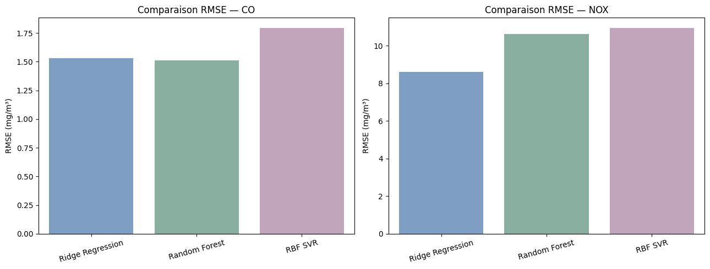
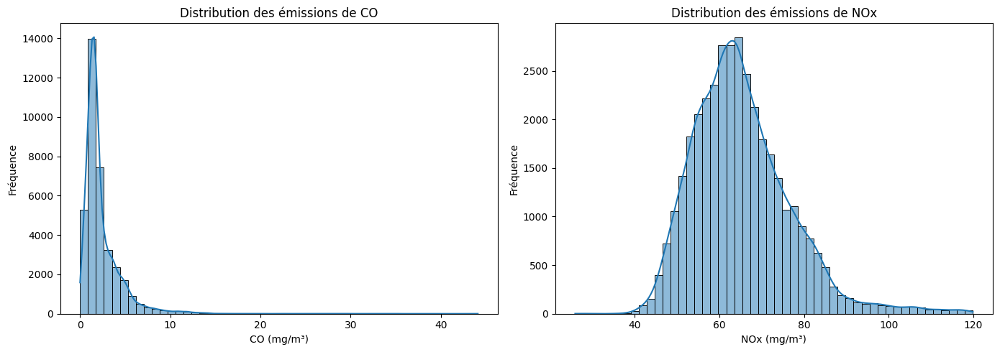
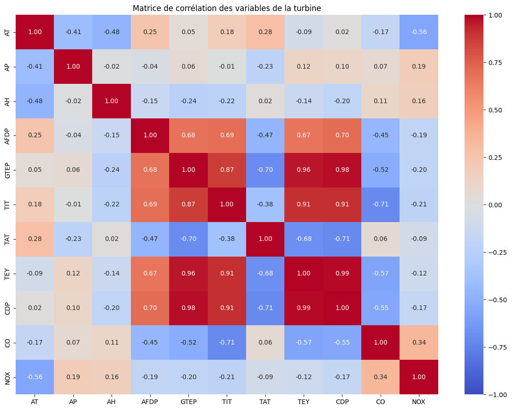
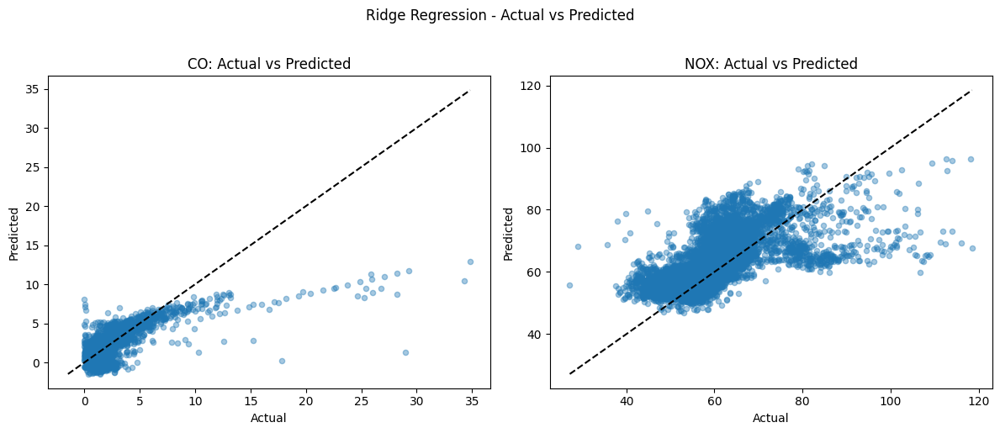
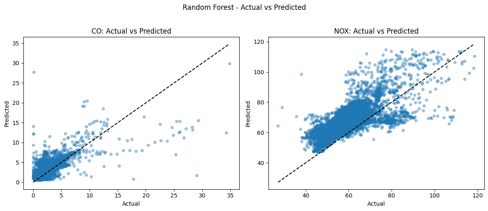
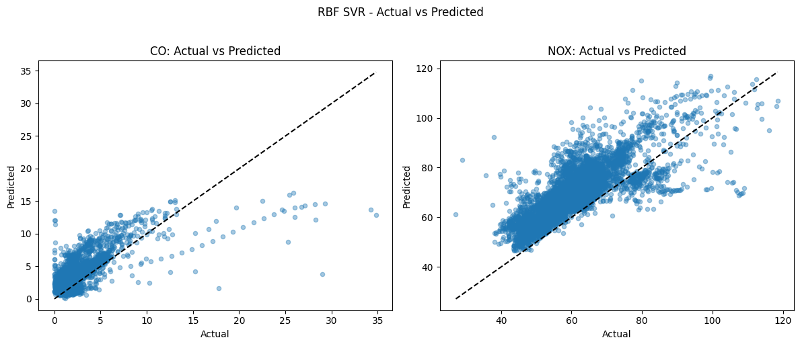

# Gas Turbine Emissions Analysis

**Exploratory Data Analysis and Machine Learning Prediction of Gas Turbine CO and NOx Emissions**

A reproducible Jupyter Notebook project analyzing industrial gas turbine sensor measurements to understand and predict two pollutants: **carbon monoxide (CO)** and **nitrogen oxides (NOx)**.

## Project overview

The dataset contains **36,733 hourly aggregated observations (2011–2015)**, with **nine sensor/operating features** and two emission targets. This project explores: data quality, pollutant distributions and outliers, sensor correlations, annual distribution shifts, and supervised regression with Ridge, Random Forest and RBF SVR.

**Dataset:** [UCI Gas Turbine CO and NOx Emission Data Set (ID 551)](https://archive.ics.uci.edu/dataset/551/gas+turbine+co+and+nox+emission+data+set).

## Validation strategy

- **Train:** 2011–2013 (22,191 samples)
- **Validation:** 2014 (7,158 samples)
- **Held-out test:** 2015 (7,384 samples; **not used** in the reported comparison)

Ridge and RBF SVR use standardized sensor variables. RBF SVR trains on a reproducible **5,000-row subset** to control runtime. Random Forest trains on the full train split. The unequal sample budgets are a caveat when comparing models.

## Results — 2014 validation

| Model | CO MAE | CO RMSE | CO R² | NOx MAE | NOx RMSE | NOx R² |
|---|---:|---:|---:|---:|---:|---:|
| Ridge Regression | 0.9081 | 1.5313 | 0.4178 | **6.5353** | **8.6175** | **0.2531** |
| Random Forest | **0.7872** | **1.5136** | **0.4311** | 9.1604 | 10.6224 | -0.1349 |
| RBF SVR | 1.2442 | 1.7934 | 0.2014 | 9.5032 | 10.9394 | -0.2037 |

All MAE and RMSE values are in mg/m³. **Lower is better** for MAE and RMSE; **higher is better** for R². Random Forest has the best CO RMSE, while Ridge generalizes better for NOx on the 2014 validation period.



## Exploratory visualizations

**Pollutant distributions**



**Correlation heatmap**



**Actual vs predicted — Ridge, Random Forest and SVR**







## Repository structure

```text
gas-turbine-emissions-analysis/
├── notebooks/gas_turbine_analysis.ipynb
├── dataset/README.md
├── scripts/download_dataset.py
├── figures/
├── requirements.txt
├── .gitignore
└── README.md
```

## Run locally

```bash
git clone https://github.com/YOUR_USERNAME/gas-turbine-emissions-analysis.git
cd gas-turbine-emissions-analysis
python3 -m venv .venv
source .venv/bin/activate  # Windows: .venv\Scripts\activate
pip install -r requirements.txt
python scripts/download_dataset.py
jupyter lab
```

Then open `notebooks/gas_turbine_analysis.ipynb` and **Run All**. You can also download the original annual CSVs manually and place them in `dataset/` (see `dataset/README.md`). The notebook works when launched from either the project root or the `notebooks/` directory. The original cells and their saved visual outputs are preserved.

## Methodological notes

- IQR outliers are **statistical flags**, not automatically invalid readings or confirmed combustion faults.
- Strong correlations among operating features (e.g., TEY, CDP, GTEP) do not establish causality.
- The dataset describes **gas turbines**, not biomass combustion.
- PCA, clustering, and Isolation Forest can be explored as **future extensions**; they are not implemented in this notebook.

## Author

**Chaimae Elbahchoumi** — Data & AI Engineering, ENSA Khouribga.
